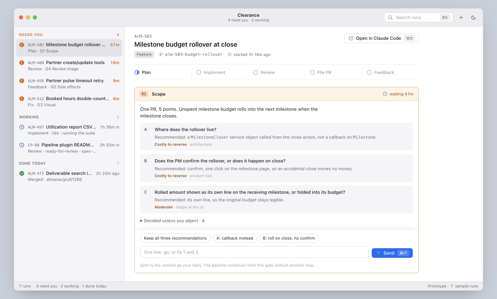

# Clearance

A Mac control room for concurrent Claude Code pipeline runs. Every run holds at a gate until you clear it; Clearance shows which runs are waiting, which gate each is on, and lets you answer in place.

It reads the runs you already have open in the Claude desktop app and can start new ones itself.



*Sample data: the runs, issue IDs, and gate text are synthetic examples from the `clearance.html` prototype, which shares the app's UI.*

> [!WARNING]
> **Clearance is a prototype.** It was built to try out one person's workflow and is not supported software. Expect rough edges, missing features, and breaking changes without notice.
>
> - It reads files that Claude Code and the Claude desktop app write for their own use. None of them is a public interface, and any update to either app can break Clearance.
> - It runs `claude` in auto mode in worktrees it creates. Watch what your runs do, and keep work you care about committed.
> - The app is unsigned and macOS only. Some paths are untested, for example handing a run to Claude Code while its worktree has uncommitted changes.

## The idea

Clearance is a concept as much as a tool. It is how I think about developing software with agents, made concrete enough to use every day.

I run several Claude Code sessions at once, usually one Linear issue each, in their own worktrees. The agents do most of the work between decisions. My job is the decisions: what is in scope, whether the plan is right, whether the UI looks right, which review findings matter, and whether something may leave my machine. With five sessions going, I am the bottleneck. The work that matters most is noticing which run is waiting on me and answering it quickly, without rereading a whole transcript.

The `/pipeline` skill (from the `pipeline` plugin) writes that process down. A feature run moves through five fixed stages: plan, implement, review, file PR, and reviewer feedback. A bug run skips plan and starts with the fix. The run stops for a human only at five gates:

| Gate | When | What I decide |
| --- | --- | --- |
| **G1 Scope** | plan, first round | the PR split and at most three questions that are expensive to reverse |
| **G2 Plan** | plan, last round | the plan, ending in "Implement?" |
| **G3 Visual** | implement, when the diff touches UI | a screenshot on real data, with each visual compromise as a question |
| **G4 Review triage** | review | the verified findings, each marked fix, skip, or ask |
| **G5 Side effects** | any stage | a push, merge, Linear write, or anything else visible outside my machine |

Between gates the agent doesn't stop to ask. At a gate it ends its turn with a question and waits.

Clearance is the control room for that flow. The Claude desktop app lists sessions by title. Clearance lists runs by what they need from me: waiting runs first, longest wait at the top, each with its stage and gate. A gate is answered where it is read, usually in one line ("go", "fix 1 and 3"), and the full session is one keystroke away. `PRODUCT.md` has the longer version.

## Requirements

- macOS, with the Claude desktop app and the `claude` CLI installed and signed in
- The `pipeline` plugin from RoleModel/claude-plugins, which defines the stages and gates Clearance shows
- Node and pnpm, to build it

## How it works

Runs follow the stages of the `pipeline` plugin (RoleModel/claude-plugins): plan, implement, review, file PR, feedback, stopping only at the five human gates G1 to G5.

**Observed runs** come from four files Claude Code and the desktop app already write:

| Source | What it supplies |
| --- | --- |
| `~/.claude/plugins/store/pipeline_*.json` | stages and notes per session |
| `~/Library/Application Support/Claude/claude-code-sessions/…/local_*.json` | title, worktree, branch, PRs, and whether the session is blocked |
| `~/.claude/sessions/<pid>.json` | busy or idle, for live processes only |
| `~/.claude/projects/<cwd>/<session>.jsonl` | the gate's own text and any pending `AskUserQuestion` |

They can be read but not answered here, because the pending question belongs to the desktop app's interactive process. The composer becomes "Open in Claude Code" (⌘O), which switches the desktop app to that session through its `claude://code/continue?session=<id>` link. ⌃⌥C brings Clearance back from anywhere.

**Owned runs** start from the New Run sheet (⌘N). The Repository menu lists the repositories the desktop app has made worktrees in, plus any you added with "Choose folder…" (remembered in `~/Library/Application Support/Clearance/repos.json`). Clearance creates a worktree under the repository's `.claude/worktrees`, then spawns your signed-in `claude` in auto mode:

```
claude -p --input-format stream-json --output-format stream-json --verbose \
  --permission-mode auto --permission-prompt-tool mcp__clearance__permission \
  --mcp-config '{…}' --session-id <uuid> "/pipeline feature ALM-520 …"
```

Auto mode decides routine permissions. What it escalates, and every `AskUserQuestion`, reaches a small MCP server bundled with the app, which forwards the request to Clearance and returns your decision. Gates that end the turn with a question are answered by sending a message to the run. A run whose process exited resumes with `--resume` when you send to it.

**Switching** works for owned runs. Continue in Claude Code (⌘O) stops Clearance's process and opens `claude://resume?session=<id>`, which makes the desktop app import the session with its history. The first import gives the session a new id, and Clearance follows it through the session file the desktop writes at the run's worktree. While the desktop holds the run, Clearance shows its gate and activity but cannot answer: a second `claude` on one session forks the conversation, and neither side sees the other's turns. Archive the session in Claude Code to stop its process; the composer comes back, and sending resumes the run here. Continue in Claude Code again reopens the same session with Clearance's turns in it. Runs started in the desktop app don't switch, because archiving one can remove the worktree the desktop made for it.

Clearance never reads, stores, or proxies Claude credentials. It only runs the unmodified `claude` binary you are already signed into.

## Develop

```bash
pnpm install
pnpm test        # vitest over app/core
pnpm start       # build and launch
pnpm dist        # unsigned Clearance.app in release/
```

Because the app is unsigned, macOS blocks the first launch of `Clearance.app`. Right-click it and choose Open, or allow it under System Settings → Privacy & Security.

`app/core` holds the pure parsers (store → stages, session → run, transcript → gate, stream-json → gate, ordering) and is the only tested layer. `app/main` is the Electron side: file watching, process spawning, the permission server. `app/renderer` is the UI, ported from the prototype in `clearance.html`.

Dev-only environment variables: `CLEARANCE_WIN=1600x1000` sets the window size, `CLEARANCE_SHOT=<png>` captures the window after load and exits, `CLEARANCE_SMOKE_START='{"kind","task","repoPath"}'` starts an owned run at launch, `CLEARANCE_SMOKE_ANSWER='{"id","text","after"}'` answers one, `CLEARANCE_DEBUG=1` echoes the runs' stderr.

## Design

`PRODUCT.md` holds the product truth, `DESIGN.md` the design system recorded from the built prototype, and `.impeccable/surfaces/` the surface brief. The visual direction is the macOS productivity canon at the craft level of Linear, Raycast, and Apple Mail.
